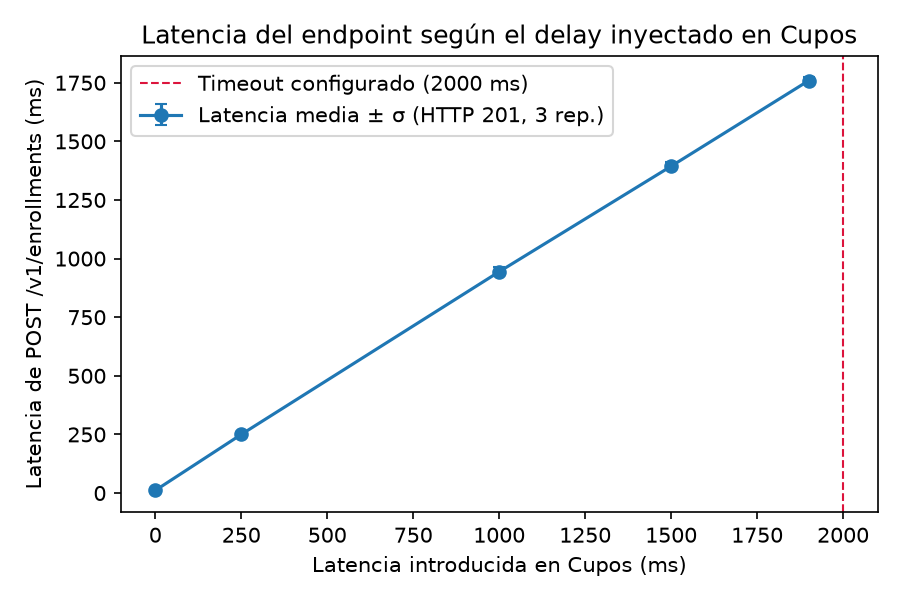
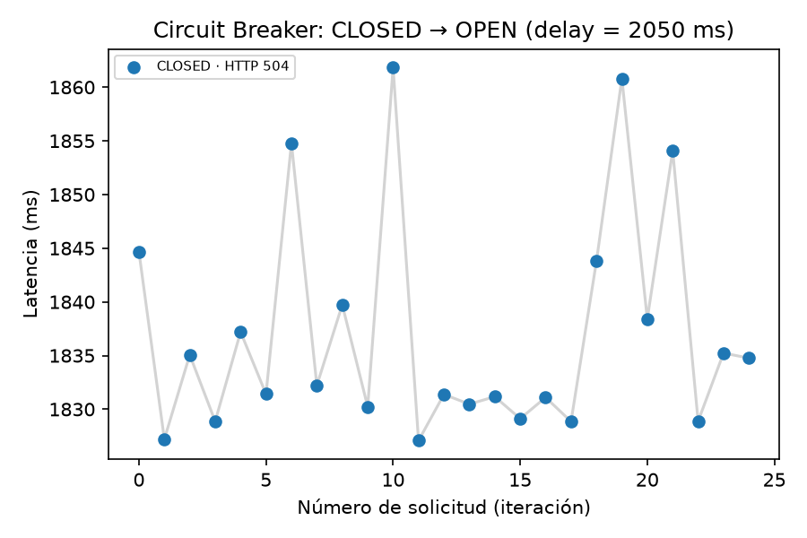
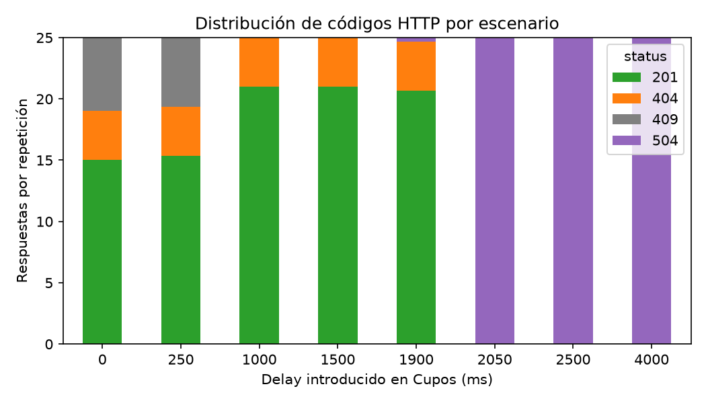
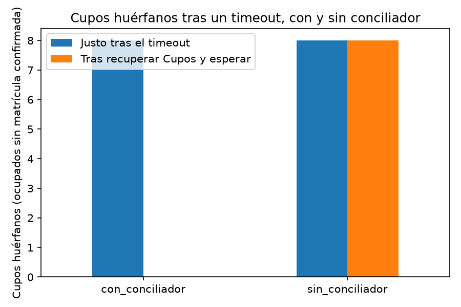

# Experimentos de resiliencia y rendimiento

Esta carpeta contiene los experimentos utilizados para evaluar la integración
entre **Matrículas-API** y **Cupos**. El objetivo no es solamente comprobar
que la API responda ante condiciones normales, sino observar su comportamiento
cuando una dependencia presenta latencia, cuando una operación queda en un
estado incierto y cuando aumenta la concurrencia.

Los experimentos se ejecutan contra los servicios reales levantados mediante
Docker Compose. Por tanto, los resultados dependen del hardware, de la carga
del equipo y de la configuración utilizada en cada corrida. Los datos crudos
se conservan en `data/raw/` para que las tablas y figuras puedan regenerarse.

## 1. Preparación del entorno

Desde la raíz del repositorio, levantar los servicios necesarios:

```bash
docker compose up -d --build cupos matriculas-db matriculas-api
```

Instalar las dependencias de los scripts:

```bash
python -m pip install -r tests/requirements.txt
```

La API debe estar disponible en `http://localhost:8000`. Los scripts utilizan
la configuración de autenticación y de conexión definida por el proyecto; no
es necesario levantar un proxy adicional para inyectar latencia, porque Cupos
ofrece el parámetro `SIMULAR_LATENCIA_MS`.

## 2. Diseño experimental

Cada experimento define una hipótesis, una variable independiente y métricas
observables. Las variables controladas se mantienen constantes dentro de una
corrida para que los cambios en las mediciones puedan atribuirse, en la medida
de lo posible, al factor estudiado.

### 2.1. Timeout y circuito de protección

**Script:** `scripts/timeout.py`

**Pregunta:** ¿cómo cambia la latencia y el código HTTP de
`POST /v1/enrollments` cuando Cupos se vuelve progresivamente más lento?

**Hipótesis:** mientras la latencia de Cupos permanezca bajo el límite
configurado, las solicitudes deberían completarse normalmente. Al superar
`CUPOS_GRPC_TIMEOUT_SECONDS`, Matrículas-API debería interrumpir la espera y
responder `504 CUPOS_TIMEOUT`. Después de varias fallas consecutivas, el
circuit breaker debería pasar de `CLOSED` a `OPEN` y responder rápidamente con
`503 CUPOS_NO_DISPONIBLE`, sin volver a esperar a Cupos.

**Variables y controles:**

- **Independiente:** latencia artificial de Cupos
  (`SIMULAR_LATENCIA_MS`).
- **Dependientes:** código HTTP, latencia de la solicitud y estado del
  circuito.
- **Controladas:** timeout gRPC, curso utilizado, hardware y número de
  solicitudes por escenario.

El barrido predeterminado utiliza latencias de `0`, `250`, `1000`, `1500`,
`1900`, `2050`, `2500` y `4000 ms`, con 25 solicitudes por escenario.
Los valores de `1900` y `2050 ms` permiten observar el comportamiento
inmediatamente antes y después del timeout predeterminado de 2 segundos.
Cada escenario reinicia Matrículas-API para que el circuito comience cerrado.
Además, se incluye periódicamente el curso `999`, que no existe, como control
funcional: sus respuestas `404` no deben confundirse con fallas causadas por
la latencia de Cupos.

Ejecutar tres repeticiones del barrido:

```bash
python experiment/scripts/timeout.py --label timeout2s --reps 3
```

Para estudiar otro timeout, modificar `CUPOS_GRPC_TIMEOUT_SECONDS` en `.env`,
reconstruir Matrículas-API y utilizar una etiqueta diferente:

```bash
docker compose up -d --build matriculas-api
python experiment/scripts/timeout.py --label timeout5s --reps 3
```

### 2.2. Consistencia de cupos después de un timeout

**Script:** `scripts/consistencia.py`

**Pregunta:** ¿qué ocurre con el cupo reservado por Cupos cuando Matrículas-API
deja de esperar y la matrícula no alcanza a confirmarse?

**Hipótesis:** una operación que supera el timeout puede continuar ejecutándose
en Cupos y dejar un cupo ocupado sin una matrícula confirmada. Sin
conciliación, esa ocupación huérfana debería persistir. Con el conciliador,
las matrículas `PENDIENTE` deberían caducar y liberar el cupo, de modo que la
cantidad de huérfanos vuelva a cero después del TTL y del intervalo de
conciliación.

**Variables y controles:**

- **Independiente:** conciliador apagado
  (`RECONCILE_INTERVAL_SECONDS=0`) o encendido (1 segundo).
- **Dependientes:** cupos huérfanos inmediatamente después del timeout,
  matrículas `PENDIENTE`, cupos huérfanos finales y segundos hasta resolver.
- **Controladas:** latencia de Cupos de 3000 ms, timeout de 2000 ms, curso 4,
  ocho solicitudes, concurrencia de cuatro, TTL de 6 segundos y umbral del
  circuito suficientemente alto para que las solicitudes lleguen a Cupos.

El script ejecuta ambos modos en cada repetición y guarda una fila por modo:

```bash
python experiment/scripts/consistencia.py --label consistencia --reps 3
```

La métrica de cupos huérfanos se calcula como la diferencia entre las
ocupaciones observadas en Cupos y las nuevas matrículas `CONFIRMADA`. Esta
medición permite distinguir la respuesta que recibe el cliente de la
consistencia efectiva entre ambos servicios.

### 2.3. Throughput bajo carga

**Script:** `scripts/throughput.py`

**Pregunta:** ¿cómo se comportan el throughput y la latencia cuando aumenta
la cantidad de solicitudes simultáneas?

**Hipótesis:** con poca concurrencia, la latencia debería mantenerse
relativamente estable. Al aparecer un cuello de botella —por ejemplo, en el
pool de conexiones de PostgreSQL, en los hilos gRPC o en las escrituras de
SQLite— el throughput debería dejar de crecer y el p95 debería aumentar.

**Variables y controles:**

- **Independiente:** concurrencia, con niveles de `1`, `5`, `10`, `20` y `40`.
- **Dependientes:** solicitudes por segundo (`rps`), latencia p50, latencia
  p95 y tasa de éxito.
- **Controladas:** endpoint, hardware, 60 solicitudes por nivel y cursos
  distribuidos entre los cursos 1 a 4.

Cada solicitud crea un estudiante, realiza una matrícula y revierte la
operación inmediatamente cuando tiene éxito. Así se evita agotar los cupos o
dejar datos de prueba activos:

```bash
python experiment/scripts/throughput.py
```

El resultado se guarda como CSV en `data/raw/`. El nivel de saturación se
identifica cuando el `rps` deja de aumentar o cuando el p95 presenta un
incremento pronunciado. Este script no genera una figura automáticamente; sus
mediciones pueden graficarse a partir del CSV si se requiere incorporarlas al
informe.

## 3. Datos y repetibilidad

Los scripts escriben los CSV en `data/raw/` con una etiqueta y una marca
temporal. Se recomienda ejecutar al menos tres repeticiones para reducir el
efecto de variaciones accidentales del entorno:

```bash
python experiment/scripts/timeout.py --label timeout2s --reps 3
python experiment/scripts/consistencia.py --label consistencia --reps 3
```

El graficador acepta el CSV del timeout y, opcionalmente, el CSV de
consistencia:

```bash
python experiment/graficar_experimentos.py \
  experiment/data/raw/timeout2s_<fecha>.csv \
  experiment/data/raw/consistencia_<fecha>.csv
```

Cuando existen varias repeticiones, las figuras muestran promedios por
escenario y, en la figura de latencia, la desviación estándar. Los CSV
generados por las corridas se versionan en `data/raw/`; esto permite conservar
la evidencia utilizada para elaborar el informe.

## 4. Figuras generadas

Todas las figuras se guardan en `results/`. Las siguientes imágenes
corresponden a los resultados actualmente producidos por
`graficar_experimentos.py`:

### Latencia en función del delay



**Archivo:** `results/latencia_vs_delay.png`

Compara la latencia media de las respuestas `201` con la latencia introducida
en Cupos. Las barras de error representan la desviación estándar entre
repeticiones y la línea vertical marca el timeout configurado de 2000 ms.
Las respuestas `404` se excluyen porque corresponden al control funcional y no
a una medición de la dependencia lenta.

### Transición del circuit breaker



**Archivo:** `results/circuit_breaker_transition.png`

Muestra, para el escenario de 2050 ms, la latencia de cada solicitud y la
transición del circuito desde `CLOSED` hacia `OPEN`. El color representa el
estado del circuito y la forma identifica el código HTTP: `504`, `503` o
`404`.

### Distribución de códigos HTTP



**Archivo:** `results/status_por_delay.png`

Presenta el número promedio de respuestas de cada código por escenario. Permite
observar el cambio desde respuestas exitosas hacia `504` por timeout y,
posteriormente, hacia `503` por circuito abierto, sin perder de vista los
`404` del control funcional.

### Consistencia de cupos



**Archivo:** `results/consistencia_cupos.png`

Compara los cupos huérfanos inmediatamente después del timeout con los
registrados después de recuperar Cupos y esperar la resolución. La comparación
entre los modos con y sin conciliador permite evaluar directamente la
mitigación del estado incierto.

## 5. Interpretación y límites

Los resultados deben interpretarse como evidencia del comportamiento de esta
implementación bajo la configuración indicada, no como una caracterización
universal del rendimiento del sistema. En particular, el throughput depende
del hardware y de la carga concurrente disponible, mientras que los umbrales
del circuit breaker, el timeout y el TTL determinan la forma de las curvas.
Por ello, cualquier conclusión del informe debe acompañarse de la
configuración, el número de repeticiones y los CSV utilizados para generarla.
