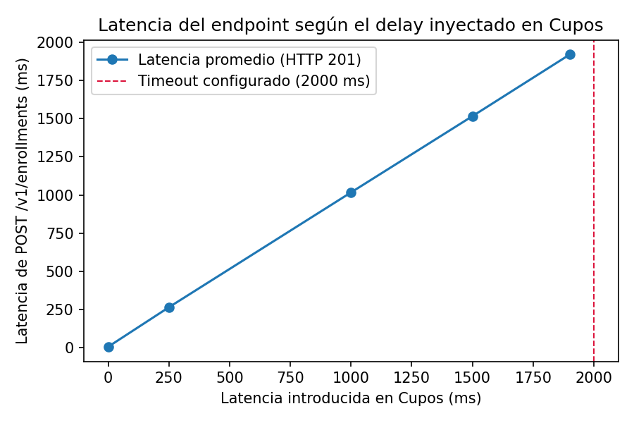
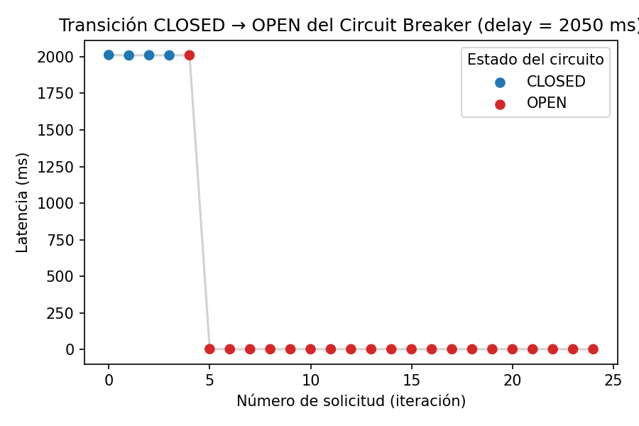

::: titlepage
[image]{.image .placeholder original-image-src="udec_logo.png"
original-image-title="" width="35%"}

**UNIVERSIDAD DE CONCEPCIÓN\
FACULTAD DE INGENIERÍA\
DEPARTAMENTO DE INGENIERÍA INFORMÁTICA Y CIENCIAS DE LA COMPUTACIÓN**

**Tarea 1 - Forma K**\
Integración de Sistemas \[501451\]

Por\
**Andrés Ignacio Chaparro Maldonado**\
**Valeria Paulette Quiroga Carrere**\
**Bastián Alexander Bernal Villegas**\
Docente: **Gonzalo Pérez Correa**\

25 / Septiembre / 2026\
:::

# Análisis del Problema

El problema presentado corresponde al Centro de Formación Técnica
AprendeMás, que cuenta con dos servicios independientes: Cupos y
Matrículas, los cuales actualmente no se encuentran integrados.

Ambos servicios fueron desarrollados por separado dentro de la
institución para cumplir sus respectivas funciones. El servicio Cupos se
encarga de administrar los cursos y los cupos disponibles para cada uno.
En este servicio se mantiene la información sobre qué cursos se dictan
en el centro, cuántos cupos tiene cada curso y cuántos de ellos se
encuentran ocupados.

Por otra parte, el servicio Matrículas está encargado de registrar a los
estudiantes del centro y sus matrículas, además de permitir su
inscripción en los cursos correspondientes.

El problema surge debido a la falta de comunicación entre ambos
servicios. Actualmente, el servicio de Matrículas no verifica la
disponibilidad de cupos antes de inscribir a un estudiante en un curso,
lo que permite que se registren matrículas que superen la capacidad
disponible de los cursos a los que se encuentre asociado para ese
semestre en particular.

Por esta razón, se requiere integrar ambos sistemas de manera que el
servicio de Matrículas pueda consultar la disponibilidad de cupos antes
de realizar una inscripción. De esta forma, las matrículas podrán
realizarse considerando la información mantenida por el servicio Cupos,
evitando que se supere la capacidad disponible y solucionando la falta
de comunicación entre ambos servicios.

Los principales requisitos de cada servicio son los siguientes:

**Servicio Matrículas**

- Gestionar la creación, consulta y listado de estudiantes.

- Permitir matricular a un estudiante en un curso cuando existan cupos
  disponibles y revertir la operación cuando corresponda.

- Consultar y listar los estudiantes inscritos en un curso determinado.

**Servicio Cupos**

- Permitir la consulta de los cupos disponibles para un curso
  determinado.

- Implementar un método para listar los cursos ofertados por el centro.

- Implementar un método para ocupar un cupo de un curso determinado solo
  cuando existan cupos disponibles.

- Implementar un método para liberar los cupos que ya no vayan a ser
  utilizados.

# Diseño de la solución

La solución propuesta mantiene los sistemas de Matrículas y Cupos como
dos servicios independientes, integrándolos mediante interfaces de
comunicación explícitas. Esta decisión busca conservar la separación de
responsabilidades existente entre ambos sistemas, evitando que la
solución dependa directamente de las implementaciones internas de cada
uno.

Como se muestra en la Figura  [1](#fig:integracion){reference-type="ref"
reference="fig:integracion"}, el sistema de Matrículas constituye el
punto de entrada para las operaciones realizadas por los usuarios
externos. Para ello, se incorpora una API REST, a través de la cual
clientes externos pueden realizar operaciones relacionadas con
estudiantes y matrículas. Internamente, Matrículas mantiene la lógica
correspondiente a su dominio y administra sus propios datos.

Por otra parte, Cupos mantiene la responsabilidad sobre los cursos y su
disponibilidad. Este sistema incorpora un servicio gRPC interno,
destinado a atender las solicitudes provenientes de Matrículas. De esta
manera, Cupos continúa siendo la fuente de verdad respecto de la
cantidad de cupos disponibles y conserva el control sobre la lógica
necesaria para consultar o modificar dicha información.

Mediante esta solución, cuando se haga una solicitud de inscripción de
matricula mediante la API REST, el sistema utiliza el servicio gRPC para
comunicarse con el servicio de Cupos, coordinando una respuesta
coherente con la realidad de los cursos y el estado final en el que
concluya la matricula según la lógica de negocio establecida en el
problema.

<figure id="fig:integracion" data-latex-placement="H">

<figcaption>Arquitectura de integración entre los sistemas.</figcaption>
</figure>

## Descomposición de la solución

La decisión de mantener ambos sistemas separados no implica que una
arquitectura unificada sea necesariamente incorrecta. El desarrollo de
un sistema que fusione las funciones de Matrículas y Cupos en una
aplicación reduciría la complejidad de comunicación y eliminaría
problemas asociados a la interacción entre servicios. Sin embargo, dado
que estos sistemas ya existían previamente gestionando procesos
distintos, el decidir reconstruir ambos sistemas no solo significaría
renunciar a la encapsulación de responsabilidad únicas que posee cada
uno, perdiendo facilidad en la escalabilidad y mantención de los
sistemas, sino que también iría en contra de la naturaleza de la
organización y como ha operado hasta la actualidad, por lo que se
termina por optar conservar sus limites e integrarlos como dos
servicios.

Matrículas tiene como responsabilidad gestionar estudiantes y
matrículas, mientras que Cupos administra los cursos y constituye la
fuente de verdad sobre su disponibilidad. Estas responsabilidades
corresponden a dominios diferentes y requieren que cada sistema mantenga
control sobre la información que administra.

Mantener esta separación permite que cada servicio encapsule su propia
lógica y datos, exponiendo únicamente las operaciones que los demás
componentes necesitan utilizar. En particular, Matrículas puede
consultar la disponibilidad de un curso sin conocer cómo Cupos almacena
o calcula internamente dicha información.

Además, ambos sistemas presentan patrones de acceso diferentes. Las
operaciones de Matrículas corresponden principalmente a acciones
relacionadas con estudiantes e inscripciones, mientras que la
disponibilidad de los cursos puede ser consultada con una frecuencia
considerablemente mayor. Mantener los servicios separados permite que
estas características sean gestionadas de manera independiente.

Por lo tanto, la separación no se adopta simplemente por utilizar una
arquitectura distribuida ni porque esta sea intrínsecamente superior a
una solución monolítica. Se adopta principalmente para conservar la
separación de responsabilidades y de propiedad de los datos que ya
existe entre ambos sistemas, utilizando la integración para permitir que
colaboren cuando una operación requiere información del otro.

## Interfaces de comunicación

La comunicación con los sistemas se divide en dos interfaces, de acuerdo
con el tipo de consumidor. Debido a que el sistema de Matrículas forma
parte de un proceso fundamental para las operaciones de la institución,
se infiere que eventualmente será necesario que el sistema sea accesible
ya sea por personal o por los alumnos mediante alguna plataforma web.
Por esta razón, se implementa una API REST de Matrículas la cual
constituye la interfaz destinada a los consumidores externos, REST
permite exponer las operaciones del sistema mediante una interfaz basada
en HTTP, separando el acceso externo de la lógica interna de Matrículas.
El servicio gRPC de Cupos, en cambio, se utiliza como interfaz interna
entre los sistemas. Matrículas actúa como cliente gRPC y Cupos como
servidor. Esta interfaz permite definir de manera explícita las
operaciones que Matrículas puede solicitar a Cupos, sin otorgarle acceso
directo a la implementación o almacenamiento interno del servicio.
Debido a estar asociado a procesos fundamentalmente administrativos y de
gestión interna de la institución, y que el sistema de Matrículas
necesita hacer muchas llamadas a este, gRPC se vuelve el método ideal
para este caso en el cual, la comunicación externa no será tan
relevante, pero si lo será la eficiencia del proceso. Esta separación de
interfaces también permite mantener distintos niveles de exposición: la
API REST constituye el punto de entrada externo de la solución, mientras
que el servicio gRPC está destinado exclusivamente a la comunicación
interna entre los sistemas.

## Flujo de integración

Ante una solicitud de matrícula, el cliente realiza la petición a través
de la API REST de Matrículas. El sistema procesa la solicitud y, para
cada curso al que este inscrito ese estudiante durante el semestre de
esa matriculación, se utiliza el cliente gRPC para realizar la consulta
correspondiente al servicio de Cupos.

Cupos procesa la solicitud utilizando su propia lógica y datos, y
devuelve a Matrículas la información necesaria para continuar con la
operación. Matrículas utiliza esta respuesta para determinar el
resultado de la solicitud y responder finalmente al cliente mediante la
API REST y actualizando los estados en su base de datos, manteniendo una
inscripción parcial de las asignaturas que se encontraran disponibles.

De esta manera, la integración permite que ambos sistemas participen en
una misma operación sin perder sus límites de responsabilidad.
Matrículas se encarga de las operaciones relacionadas con la matrícula,
mientras que Cupos mantiene la autoridad sobre la disponibilidad de los
cursos.

# ADRs

## D1 - Estilo de integración y descomposición

El Centro de Formación Técnica AprendeMás opera dos sistemas que
nacieron y evolucionaron de manera independiente: *Cupos*, responsable
de administrar cursos y disponibilidad, y *Matrículas*, encargado del
registro de estudiantes y matrículas. Para confirmar una matrícula,
Matrículas necesita consultar frecuentemente el estado de los cupos
disponibles y actualizar dicha información de forma consistente.

El problema principal de diseño consiste en determinar si ambos dominios
deben integrarse como una única aplicación o mantenerse separados
mediante mecanismos de comunicación explícitos.

Se analizaron distintas alternativas arquitectónicas. La integración
orientada a eventos fue descartada como mecanismo principal de
coordinación, debido a que el proceso de matrícula requiere consultas
síncronas y respuestas inmediatas sobre la disponibilidad de cupos. Un
enfoque basado únicamente en eventos introduciría consistencia eventual,
dificultando garantizar que la información presentada al usuario
corresponda al estado actual de los cupos.

También se descartó la adopción de una solución *Serverless*, ya que el
alcance del proyecto requiere servicios con estado persistente,
comunicación continua entre componentes y despliegue controlado dentro
de un entorno basado en contenedores, alineado con los requisitos
técnicos del encargo.

**Alternativas consideradas.**

- **Monolito único.** Fusionar Cupos y Matrículas en una única
  aplicación y una base de datos compartida. Esta alternativa simplifica
  la comunicación entre módulos y reduce la infraestructura necesaria,
  pero incrementa el acoplamiento entre dominios que originalmente
  fueron desarrollados por separado. Además, dificulta la evolución
  independiente de cada sistema y aumenta el impacto de fallas o cambios
  sobre el conjunto completo de la aplicación.

- **Dos Servicios independientes, cada uno con su propia base de datos,
  comunicados mediante contratos explícitos.** Mantiene la separación
  entre ambos dominios, permite la evolución independiente de cada
  servicio y satisface el requisito de base de datos por servicio. Como
  contrapartida, introduce mayor complejidad de integración,
  coordinación y manejo de errores.

Se adopta la segunda alternativa, implementando dos servicios
independientes: Cupos y Matrículas, cada uno con su propia base de datos
y comunicados exclusivamente mediante contratos versionados. Matrículas
expone una API REST como interfaz pública, mientras que Cupos expone un
servicio gRPC para consultas y modificaciones de disponibilidad.

Esta decisión se justifica porque ambos sistemas representan dominios
distintos, fueron desarrollados en momentos diferentes y no comparten
directamente sus datos. El alcance del proyecto se limita a resolver la
interacción necesaria para la gestión de cupos durante el proceso de
matrícula, sin requerir una unificación completa de ambos sistemas.

La separación en servicios establece fronteras de responsabilidad claras
y permite que cada componente evolucione de manera independiente,
siempre que se respeten los contratos de integración. Esta decisión
corresponde al patrón de API REST para consumidores externos y gRPC para
comunicación interna entre servicios.

Como consecuencia, se acepta una mayor complejidad operacional respecto
de un monolito, incluyendo la necesidad de administrar comunicación
remota, contratos de integración, manejo de errores, timeouts y
recuperación frente a fallos de dependencias, aspectos abordados en los
ADR posteriores.

Finalmente, las responsabilidades quedan definidas de la siguiente
forma:

- **Matrículas:** administración de estudiantes, matrículas y estados
  asociados, además de exponer la API pública del sistema.

- **Cupos:** administración de cursos, cupos totales, cupos disponibles
  y operaciones de ocupación y liberación de cupos.

Matrículas consulta siempre a Cupos mediante los contratos definidos y
nunca accede directamente a su base de datos.

[Al estar desarrollados por separado, también se considera el caso donde
en ambos Servicios se usa un identificador distinto dentro de las bases
de datos respectivas. Para resolver esto, en Matriculas se implementa un
método para mapear el código del curso en Matrículas al correspondiente
en Curso de forma que se pueda usar ese para la consulta
gRPC.]{style="color: red"}

## D2 - REST frente a gRPC

Asumiendo que Matrículas expone la única API pública del sistema, punto
de entrada para el personal de la organización y para un futuro portal
web, y Cupos es un servicio interno consultado con una
significativamente alta frecuencia por Matrículas para verificar
disponibilidad antes de cada matrícula.

**Alternativas consideradas.**

- **REST/JSON en ambas caras.** Tecnología uniforme, de lectura
  amigable, fácil de testear e inspeccionar con herramientas estándar,
  pero con payloads de texto más grandes y sin tipado fuerte para la
  comunicación interna de alto volumen.

- **gRPC en ambas caras.** Contratos fuertemente tipados y mensajes
  binarios compactos también hacia el exterior, pero los navegadores no
  soportan gRPC de forma nativa y requieren una capa adicional
  (grpc-web) para consumirse desde un portal web, lo que complica
  innecesariamente la API pública.

- **REST hacia afuera, gRPC hacia adentro.** Usa cada protocolo donde
  sus ventajas pesan más.

Es por esto que se decidió optar por la tercera opción. Matrículas
expone su API pública mediante REST sobre HTTP/JSON. Cupos expone su
servicio interno mediante gRPC sobre Protocol Buffers, consumido
únicamente por Matrículas.

Protocol Buffers serializa los mensajes en formato binario en lugar de
texto, lo que produce payloads considerablemente más pequeños que su
equivalente en JSON y acelera la serialización y deserialización en
ambos extremos de la comunicación. En un caso de referencia con datos de
producción, migrar de REST/JSON a gRPC con Protobuf sobre la misma carga
de trabajo redujo el tamaño de los mensajes y mejora la latencia.
Además, gRPC corre sobre HTTP/2, que permite multiplexar solicitudes
sobre una misma conexión, y genera automáticamente el código cliente y
servidor a partir de un contrato `.proto` fuertemente tipado, lo que
reduce errores de integración entre lenguajes distintos. Estas
características son las que permiten a Cupos responder con baja latencia
al alto volumen de consultas que recibe de Matrículas.

Del lado público, REST no exige herramientas adicionales para consumirse
desde un navegador, es fácil de inspeccionar y depurar con herramientas
HTTP estándar, y permite aprovechar directamente el modelo de caché de
HTTP si en el futuro se agrega una capa de caché sobre las consultas de
disponibilidad.

A consecuencia de esta decisión se acepta mantener dos tecnologías de
comunicación en el sistema en lugar de una sola, lo que implica mantener
dos formas de definir y versionar contratos (OpenAPI y `.proto`) y
depurar la comunicación interna con herramientas menos accesibles.

Como resultado, el contrato de Cupos se define en un archivo `.proto`
versionado en el repositorio, y el de Matrículas en un archivo
`openapi.yaml`. Una falla o lentitud del servicio gRPC de Cupos impacta
directamente la disponibilidad de la API REST de Matrículas.

## D3 - Contrato, versionado y evolución

Dado que a medida que Cupos y Matrículas sigan creciendo, será necesario
modificar sus contratos: agregar campos, cambiar operaciones o corregir
el modelo de datos. Sin una estrategia de versionado, un cambio en
cualquiera de los dos contratos puede romper a los consumidores
existentes sin aviso.

**Alternativas consideradas.**

- **Sin estrategia de versionado formal.** Se descarta porque no da
  garantía de compatibilidad ni forma de revertir un cambio
  problemático.

- **Versionar el contrato completo ante cualquier cambio.** Es la opción
  más segura, pero impone a todos los consumidores una migración incluso
  cuando el cambio era compatible en la práctica.

- **Versionado explícito de la API REST combinado con las reglas de
  compatibilidad binaria de Protocol Buffers para el contrato gRPC.**
  Reserva el versionado mayor para cambios incompatibles y permite
  evolucionar el contrato sin romperlo mientras el cambio respete esas
  reglas.

Se decidió versionar explícitamente la URL de la API REST de Matrículas
(`/v1`, y en el futuro `/v2` de ser necesario). El contrato `.proto` de
Cupos evoluciona siguiendo las reglas de compatibilidad binaria propias
de Protocol Buffers [@protoguide], reservando una nueva versión del
servicio o del paquete solo para cambios incompatibles.

Ya que Protocol Buffers fue diseñado explícitamente para permitir que un
contrato se extienda con información nueva sin invalidar los datos
existentes ni forzar una actualización simultánea de todo el código que
lo consume. Esto es posible porque cada campo de un mensaje se
identifica por un número, no por su posición ni su nombre, y ese número
--- no el campo en sí --- es lo que define la compatibilidad binaria del
contrato.

Son cambios compatibles los que no requieren de una nueva versión del
contrato, como:

- Agregar un campo nuevo con un número de campo no utilizado
  previamente, de forma que los lectores antiguos puedan simplemente
  ignorarlo.

- Eliminar un campo que ya no se usa, siempre que su número se marque
  como `reserved` para que no vuelva a reutilizarse por error.

- Ampliar el rango de un tipo numérico (por ejemplo, de `int32` a
  `int64`), mientras los valores existentes permanezcan dentro del rango
  del tipo original.

- Agregar nuevos valores a una enumeración, como los estados definidos
  en `cupos.proto` (`CUPO_OCUPADO`, `SIN_CUPOS`, `CURSO_NO_ENCONTRADO`,
  `CUPO_LIBERADO`): un estado adicional futuro no rompe a los clientes
  existentes.

Son cambios incompatibles los que exigen una nueva versión del contrato:
reutilizar o reasignar el número de un campo eliminado a un campo
distinto, ya que para el receptor el dato antiguo y el nuevo son
indistinguibles en el mensaje binario, cambiar el tipo de un campo de
forma incompatible con el original, y eliminar o renombrar un método RPC
que los clientes existentes siguen invocando.

Del lado de la API REST, el versionado por URL (`/v1`) exigido por el
encargo cumple el mismo propósito de forma explícita y visible para
cualquier consumidor externo.

El mantener compatibilidad binaria en `.proto` exige que cada campo
eliminado deba reservarse en lugar de simplemente borrarse, y cada
cambio debe evaluarse contra estas reglas antes de integrarse. Es por
esto que un cambio compatible se adopta simplemente regenerando el
código cliente contra la versión más reciente del `.proto`. Un cambio
incompatible se comunica mediante una nueva versión explícita del
contrato, documentada en el repositorio junto al historial de commits.
Ambos contratos (`openapi.yaml` y `.proto`) se mantienen versionados en
el repositorio como fuente de verdad.

## D4 - Resiliencia y modos de falla

El servicio Matrículas depende de Cupos en el camino crítico de cada
matrícula: antes de registrar a un estudiante debe consultar y ocupar un
cupo a través de gRPC, por lo que si Cupos no responde, responde con
error o responde lentamente, la API REST de Matrículas no puede quedar
esperando de forma indefinida ni fallar en silencio. Sin embargo, es
necesario que la API se comporte de forma razonable ante esta falla y
que el código de estado devuelto esté justificado.

El propio servicio de Cupos incorpora una variable de entorno
(`SIMULAR_LATENCIA_MS`) pensada para inyectar latencia artificial, para
realizar el experimento de efecto del timeout.

# Alternativas consideradas {#alternativas-consideradas .unnumbered}

- **Esperar sin límite de tiempo y propagar el error de gRPC tal cual.**
  No requiere lógica adicional, pero puede mantener conexiones y hebras
  de Matrículas bloqueadas indefinidamente, sin dar al consumidor un
  código de estado claro.

- **Definir un tiempo límite (*deadline*) explícito en cada llamada gRPC
  y traducir su resultado a un código HTTP específico.** Acota el tiempo
  de espera y permite responder de forma predecible, a costa de poder
  rechazar solicitudes que habrían tenido éxito si se hubiese esperado
  un poco más.

- **Sumar a la segunda opción un *circuit breaker* y una caché de
  disponibilidad (Redis)**. Es la solución más robusta ante fallas
  sostenidas, pero excede el alcance mínimo de la implementación
  realizada, por lo que se menciona como evolución futura.

Como decisión tomada, cada llamada gRPC desde Matrículas hacia Cupos se
realiza con un tiempo límite explícito. Si el plazo se agota o Cupos no
está disponible, la API REST de Matrículas responde con un código de
error HTTP claro en lugar de propagar el error interno de gRPC o dejar
la solicitud pendiente.

Como justificación, establecer un tiempo límite por llamada acota el
consumo de recursos, protege las hebras de trabajo de Matrículas y
produce un comportamiento de falla determinista en lugar de uno
indefinido. Sin ese límite, una dependencia lenta puede agotar el pool
de conexiones o hebras disponibles y degradar a Matrículas por completo,
aunque el propio servicio funcione bien.

Para el código de respuesta conviene distinguir el tipo de falla. Cuando
el tiempo límite se agota porque Cupos no respondió a tiempo, el código
semánticamente correcto es `504 Gateway Timeout`, reservado para cuando
un servidor que actúa como intermediario no recibe una respuesta a
tiempo de un servicio del que depende, a diferencia de una respuesta
inválida (`502`) o de un rechazo explícito por sobrecarga (`503`).
Cuando la conexión hacia Cupos directamente no puede establecerse, el
código apropiado es `503 Service Unavailable`, pensado para indicar que
el servidor no está en condiciones de aceptar la solicitud de forma
temporal. Los errores de dominio que Cupos ya reporta de forma explícita
(`NOT_FOUND` cuando el curso no existe, `FAILED_PRECONDITION` cuando una
operación es inconsistente con el estado actual) no son fallas de la
dependencia y deben traducirse a códigos 4xx propios de Matrículas, no a
503/504.

Como costo aceptado, un tiempo límite fijo puede rechazar solicitudes
que habrían tenido éxito si Cupos hubiese respondido solo un poco más
tarde. Si el límite se fija demasiado corto, aumentan las matrículas
rechazadas innecesariamente. Si se fija demasiado largo, se pierde parte
de la protección que el propio límite busca dar. El valor elegido debe
calibrarse con datos, no fijarse arbitrariamente.

Como consecuencias, el valor del tiempo límite debe medirse
empíricamente, usando `SIMULAR_LATENCIA_MS` para simular distintos
escenarios de lentitud, antes de fijarse en Matrículas. Esta medición
es, a su vez, insumo directo para el experimento de la Competencia 6.
Esta decisión deja abierta la incorporación de una caché de
disponibilidad (O1) y de un *circuit breaker* si se observan fallas
sostenidas en producción.

# Experimento

Dentro de entornos de producción reales se pueden observar problemas
comunes externos al software en sí, tales como una alta congestión de
red, una mala conexión, saturación en la base de datos debido a su
volumen masivo, entre otros. Para mitigar estos problemas de
disponibilidad y evitar la degradación en cascada del sistema completo,
se implementan estrategias de resiliencia.

Es por eso que en el presente experimento el objetivo será evaluar el
comportamiento del *timeout* entre el servicio de matrículas y su
dependencia crítica, Cupos, y el patrón *Circuit Breaker* [^1] encargado
de limitar el impacto de una dependencia degradada.

## Hipótesis

Mientras la latencia inyectada en Cupos se mantenga por debajo del
timeout (2000 ms), se espera que la latencia del endpoint la siga de
forma aproximadamente lineal y que el circuito permanezca en estado
`CLOSED`. Al superar ese umbral, se espera que el timeout trunque la
espera cerca de los 2000 ms, devolviendo HTTP 503, y que una racha de
fallas consecutivas abra el circuito (`OPEN`); una vez abierto, las
solicitudes deberían rechazarse casi instantáneamente (*fail-fast*), sin
importar cuánto siga aumentando el retraso real de Cupos.

## Diseño experimental

El sistema de Matrículas depende de un servicio interno en gRPC, Cupos,
para verificar disponibilidad antes de registrar una matrícula. Esta
dependencia está protegida por dos mecanismos: un timeout de
comunicación fijo de 2000 ms y un Circuit Breaker que interrumpe las
llamadas cuando detecta fallas consecutivas. El experimento busca
observar el efecto conjunto de ambos mecanismos frente a una degradación
controlada de Cupos.

Para ello se utilizó el endpoint `POST /v1/enrollments` como punto de
observación, inyectando en Cupos una latencia artificial creciente
mediante la variable `SIMULAR_LATENCIA_MS`, con el timeout de
comunicación fijo en `CUPOS_GRPC_TIMEOUT_SECONDS = 2000 ms`. Se
evaluaron ocho niveles de retraso ---0, 250, 1000, 1500, 1900, 2050,
2500 y 4000 ms---, con 25 solicitudes consecutivas por escenario. En
cada una se registró el código HTTP, la latencia total, el código de
error de aplicación y el estado del Circuit Breaker.

## Resultados

::: {#tab:resultados}
   **Delay**   **201**   **404**   **503**      **Circuit Breaker**
  ----------- --------- --------- --------- ---------------------------
     0 ms        21         4         0               CLOSED
    250 ms       21         4         0               CLOSED
    1000 ms      21         4         0               CLOSED
    1500 ms      21         4         0               CLOSED
    1900 ms      21         4         0               CLOSED
    2050 ms       0         0        25      CLOSED $\rightarrow$ OPEN
    2500 ms       0         0        25      CLOSED $\rightarrow$ OPEN
    4000 ms       0         0        25      CLOSED $\rightarrow$ OPEN

  : Resumen por escenario
:::

Las cuatro respuestas HTTP 404 (`CURSO_NO_ENCONTRADO`) que aparecen en
todos los escenarios corresponden a identificadores de curso
inexistentes usados deliberadamente por el experimento; son un error
funcional conocido y no se consideran para evaluar timeout ni Circuit
Breaker.

<figure id="fig:latencia" data-latex-placement="H">

<figcaption>Latencia promedio de <code>POST /v1/enrollments</code> (solo
HTTP 201) según el delay inyectado en Cupos.</figcaption>
</figure>

Como muestra la Figura [2](#fig:latencia){reference-type="ref"
reference="fig:latencia"}, mientras el delay se mantiene bajo el timeout
la latencia del endpoint crece de forma prácticamente lineal con la de
Cupos: para 1000 ms de retraso las respuestas exitosas se ubicaron
alrededor de 1010--1020 ms, y para 1900 ms, alrededor de 1910--1930 ms.
Esto confirma que Cupos forma parte del camino crítico de la solicitud.

Al llegar a 2050 ms el comportamiento cambia por completo: las
solicitudes ya no esperan el retraso real de Cupos, sino que se cortan
cerca de los 2000 ms con HTTP 503 (`CUPOS_NO_DISPONIBLE`). Tras cinco
fallas consecutivas el circuito pasa a `OPEN`, y desde ese punto la
latencia cae de \~2000 ms a \~2--3 ms
(Figura [3](#fig:circuito){reference-type="ref"
reference="fig:circuito"}), aunque el código de error se mantiene en
503.

<figure id="fig:circuito" data-latex-placement="H">

<figcaption>Transición CLOSED → OPEN
del Circuit Breaker en el escenario de 2050 ms.</figcaption>
</figure>

Los escenarios de 2500 ms y 4000 ms reproducen exactamente el mismo
patrón: cuatro fallas por timeout, apertura del circuito en la quinta, y
respuestas fail-fast en adelante. Esto indica que, una vez abierto el
circuito, seguir aumentando el retraso real de Cupos deja de tener
efecto sobre lo que percibe el cliente.

## Discusión y conclusiones

Los resultados confirman la hipótesis planteada. El timeout actúa como
primera barrera: acota la espera máxima a 2000 ms y evita que la
degradación de Cupos se propague sin control hacia el cliente. El
Circuit Breaker actúa como segunda barrera, evitando que cada nueva
solicitud vuelva a pagar el costo completo del timeout una vez que la
falla se confirma como persistente. En conjunto, ambos mecanismos
describen la secuencia

$$\text{Dependencia lenta} \rightarrow \text{Timeout} \rightarrow \text{Fallas consecutivas}
\rightarrow \text{Circuit Breaker OPEN} \rightarrow \text{Fail-fast}$$

# Consideraciones de contexto

**Sincronización entre los cursos**

Durante el desarrollo de la integración se encontró la necesidad de
hacer supuestos que facilitarán el entendimiento del problema, uno de
estos constaba de la necesidad del sistema de Matriculas de administrar
parcialmente las inscripciones a los cursos, ya que, sin una referencia
a los cursos que una matricula en particular fuera a inscribirse, luego
seria imposible consultar al sistema de Cupos si el curso en cuestión le
quedaban cupos o no.

Para esto, se diseño la base de datos del sistema de matriculas de forma
que una matricula estuviera asociada a varios códigos de asignaturas en
un semestre particular, sin embargo, estos códigos no están fijados en
ninguna parte del sistema ya que Matrículas no gestiona los cursos, son
escritos de forma manual por quien use el sistema e identifique los
cursos. Esto generó una disyuntiva al momento de comunicar entre
sistemas si cierto curso estaba disponible ya que no necesariamente iban
a tener la misma referencia o forma de referirse a estos.

La solución a tal problema consistió en una nueva base de datos
exclusiva de la capa de integración que asociará todos los
`códigos de asignatura` en el sistema de Matrículas al `id`
correspondiente en el sistema de Cupos. En un principio se pensó en
mantener esos datos en un contenedor aparte ya que no corresponden a la
lógica exclusiva de ninguno de los dos sistemas, sin embargo, tal acción
provocaría depender de tener otro sistema levantado y que la `API REST`
dependa de 3 módulos en lugar de 2, por eso, en su lugar, se terminó por
guardar estos datos en la misma base de datos de Matrículas en una tabla
aparte, siendo el sistema con más sentido que la tuviera ya que es este
el módulo dependiente del otro y no viceversa.

Como detalle adicional, en el caso de producción, esta tabla debería
llenarse de forma manual si es que no existe ninguna relación entre la
forma de identificar las asignaturas de ambos sistemas o intentar
automatizarlo si es que sí. Para mantenerla actualizada en caso de haber
nuevos cursos podría hacerse de forma manual o hacerlo desde el sistema
de Cupos haciendo una llamada a la API de Matrículas con un nuevo
endpoint que lo actualice automáticamente. No se implementaron dichas
soluciones ya que están fuera del alcance de está integración.

**Decisión de tipo de streaming en gRPC**

Los cinco métodos del servicio Cupos se implementan como llamadas
unarias (una solicitud, una respuesta) porque ninguno presenta un patrón
de datos que justifique el costo adicional de un streaming.
`obtenerCupo` consulta el estado de un único curso identificado por su
curso_id, tanto la solicitud como la respuesta son de tamaño fijo y
conocido de antemano, por lo que no hay una secuencia de datos que
transmitir progresivamente. `listarCursos` y `listarCursosDisponibles`
devuelven una colección acotada del catálogo completo de cursos de la
institución, cuyo volumen se asume lo suficientemente pequeño como para
transmitirse en un único mensaje sin beneficio real de un server
streaming que entregara los cursos uno a uno. Introducir streaming aquí
solo añadiría complejidad de manejo de iteradores sin mejorar la
latencia percibida por el cliente. Finalmente, `ocuparCupo` y
`liberarCupo` son operaciones transaccionales que modifican el estado de
un curso específico de forma que cada llamada debería hacerse de forma
atómica, no en un flujo continuo de datos, y su diseño unario simplifica
además el mecanismo de idempotencia implementado, ya que un reintento
equivale a reenviar el mismo mensaje en lugar de tener que
re-sincronizar el estado de un stream interrumpido. En conjunto, el uso
exclusivo de RPC unarios refleja que la comunicación entre Matrículas y
Cupos es de tipo consulta/respuesta puntual.

**Implementación de idempotencia en las operaciones de modificación de
datos**

Para garantizar la idempotencia en los métodos del servicio Cupos que
modifican el estado de la base de datos, `ocuparCupo` y `liberarCupo`,
se incorporó al contrato definido en cupos.proto un campo
`idempotency_key` dentro de los mensajes de solicitud correspondientes.
Este campo es generado por el cliente, el servicio de Matrículas, una
única vez por cada operación de negocio y se reutiliza en caso de que
dicha operación deba reintentarse, por ejemplo ante un timeout o una
falla de red. Adicionalmente, se creó en la base de datos del servicio
una tabla dedicada a registrar las operaciones ya procesadas,
almacenando la clave de idempotencia recibida junto con el resultado que
se produjo en su primera ejecución. De esta manera, cada vez que el
servicio recibe una solicitud, verifica primero si la clave asociada ya
fue registrada con anterioridad. Si la clave existe, el servicio omite
la ejecución de la operación sobre la base de datos y responde
directamente con el resultado almacenado, evitando así que un mensaje
duplicado provoque una segunda modificación sobre los cupos disponibles
de un curso. Esta verificación y el posterior registro de la operación
se realizan dentro de una misma transacción, lo que asegura que ninguna
solicitud concurrente con la misma clave pueda ejecutarse más de una
vez, incluso si ambas llegan al servicio de forma casi simultánea.

[**Por qué API Key y no OAuth2/JWT ni Basic Auth para
Matrículas**]{style="color: red"}

1.  Los consumidores de esta API REST no son usuarios finales anónimos
    de internet, sino sistemas cliente de confianza dentro de AprendeMás
    (front-end de matrícula usado por secretaría académica,
    integraciones internas futuras). El modelo de confianza es
    máquina-a-máquina, igual que la relación entre esta misma API y el
    gRPC de Cupos: no hay un flujo de login interactivo de un estudiante
    que necesite pedir permiso (scopes), refresh tokens, ni sesiones de
    usuario que justifiquen la complejidad de OAuth2/JWT.

2.  Es stateless y barata de verificar en cada request (no requiere
    validar firmas, ni consultar un Authorization Server), lo cual
    importa porque el endpoint de matrícula ya depende de una llamada
    gRPC externa con su propio costo/latencia.

3.  Permite emitir/revocar credenciales por sistema cliente de forma
    simple (una key por integración), suficiente para trazabilidad y
    para cortar acceso a un consumidor problemático sin afectar a los
    demás.

4.  Basic Auth se descartó porque obliga a manejar un par
    usuario/contraseña que sugiere una identidad humana que esta API no
    gestiona.

Semántica de los códigos (RFC 9110):

- 401 Unauthorized: la credencial falta o NO autentica (clave
  inexistente o inválida). Es la respuesta correcta para una API key
  incorrecta: el servidor no sabe quién es el cliente.

- 403 Forbidden se reserva para un cliente ya autenticado que no tiene
  permiso para la operación. Hoy no existen roles, por lo que esta API
  no responde 403.

Costo aceptado: no captura identidad de usuario final ni scopes
granulares. Si más adelante se necesita distinguir \"qué usuario humano
matriculó\", la evolución natural es JWT (posiblemente emitido por un
Authorization Server central de AprendeMás) por sobre este mecanismo,
sin romper compatibilidad, dado que el mismo header Authorization puede
convivir con X-API-Key para clientes de servicio.

# Instrucciones de ejecución

## Levantar la integración completa (Cupos + Matrículas API)

1.  Copiar el archivo de variables de entorno de ejemplo:

        cp .env.example .env

2.  Construir y levantar los servicios de la integración:

        docker compose up --build -d cupos matriculas-db matriculas-api

3.  La API REST de Matrículas queda disponible en
    `http://localhost:8000`, con documentación interactiva
    (OpenAPI/Swagger) en `http://localhost:8000/docs`.

## CLI legado de Matrículas (referencia, sin integración)

Se mantiene únicamente a modo de comparación con el estado "antes de la
integración". No se levanta por defecto con `docker compose up`, ya que
requiere el *profile* `legacy`:

    # Preparar el esquema (una sola vez)
    docker compose --profile legacy run --rm matriculas node src/index.js

    # Ejecutar el CLI interactivo
    docker compose --profile legacy run --rm -it matriculas npm run cli

Este CLI reproduce intencionalmente el comportamiento original:
matricula estudiantes sin verificar cupos disponibles contra el servicio
Cupos.

## Servicio Cupos por separado

Para levantar únicamente el servicio Cupos:

    docker compose up --build cupos

# Reflexión final

El desarrollo de este trabajo permitió comprender que, antes de comenzar
a implementar una solución, es fundamental analizar y comprender
adecuadamente el contexto del problema y las razones que condicionan su
diseño. En una primera instancia, no se comprendía completamente por qué
los sistemas de Cupos y Matrículas debían mantenerse separados, lo que
llevó inicialmente a plantear una solución con características más
propias de un sistema monolítico que de una integración entre servicios
independientes. Esta experiencia permitió reconocer la importancia de
dedicar una etapa inicial al análisis del problema y de las
responsabilidades de cada sistema, antes de tomar decisiones de
implementación.

A partir de este análisis, fue posible comprender con mayor claridad por
qué una arquitectura compuesta por dos servicios constituía una
alternativa sólida para este escenario. Mantener separados los sistemas
permite respetar sus responsabilidades y fuentes de información,
mientras que la integración mediante servicios permite resolver la
necesidad de consultar la disponibilidad de cupos sin requerir la fusión
de ambos sistemas. De esta manera, se pudo comprender que la separación
entre sistemas no constituye necesariamente una complejidad innecesaria,
sino que puede responder a una decisión de diseño fundamentada en las
características y responsabilidades de cada uno.

Asimismo, el desarrollo de la integración permitió fortalecer la
capacidad de toma de decisiones de diseño, especialmente al enfrentarse
a decisiones de menor escala que, en conjunto, afectan el comportamiento
y las propiedades de la solución completa. Aspectos como la comunicación
entre servicios, el manejo de errores, la idempotencia y la consistencia
de las operaciones requirieron evaluar distintas alternativas y sus
respectivos compromisos. Esto permitió comprender que el diseño de
sistemas no consiste únicamente en seleccionar una arquitectura general,
sino también en tomar decisiones sucesivas que deben ser coherentes con
los objetivos y restricciones del sistema.

En síntesis, el trabajo permitió no solo implementar una integración
entre los sistemas de Cupos y Matrículas para evitar inscripciones que
excedieran la disponibilidad real, sino también desarrollar una visión
más crítica sobre el proceso de diseño de sistemas. La principal
experiencia obtenida fue comprender que una solución técnicamente
funcional no necesariamente es una solución bien diseñada: para alcanzar
esta última es necesario comprender primero el problema, justificar las
decisiones arquitectónicas y evaluar continuamente los compromisos que
surgen durante la implementación.

# Anexos {#sec:anexos .unnumbered}

# Declaración de uso de Inteligencia Artificial

En el desarrollo de este trabajo, se utilizó inteligencia artificial
como herramienta de apoyo para la revisión y corrección de aspectos
sintácticos del código, la identificación y comparación de alternativas
de implementación, la generalización de secciones repetitivas y la
documentación del código.

Asimismo, durante la elaboración del informe, se empleó para mejorar la
redacción de los textos y adaptar el contenido al formato LaTeX,
facilitando la preparación y compilación del documento. En todos los
casos, su uso tuvo como objetivo apoyar el proceso de desarrollo y
documentación del trabajo.

[^1]: El *Circuit Breaker* es un patrón de diseño de software que
    detecta fallas o demoras recurrentes en la comunicación con un
    servicio externo e interrumpe temporalmente las llamadas hacia él,
    devolviendo un error inmediato (*fail-fast*) para prevenir el
    consumo innecesario de recursos y la degradación en cascada del
    sistema.
